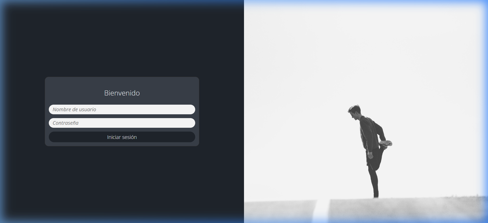
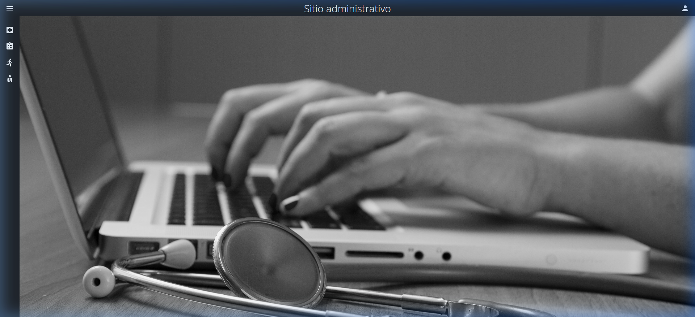
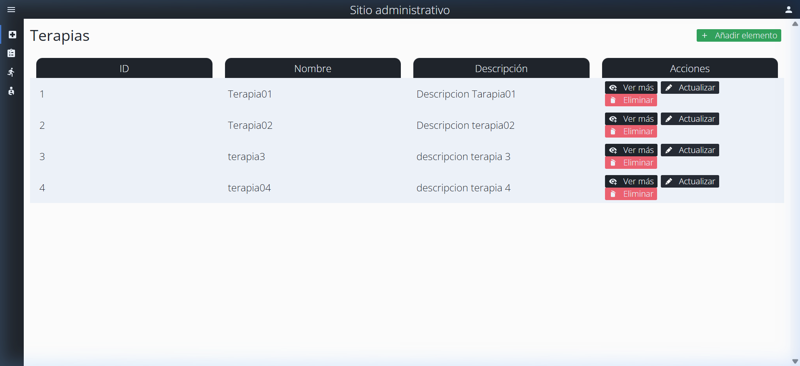
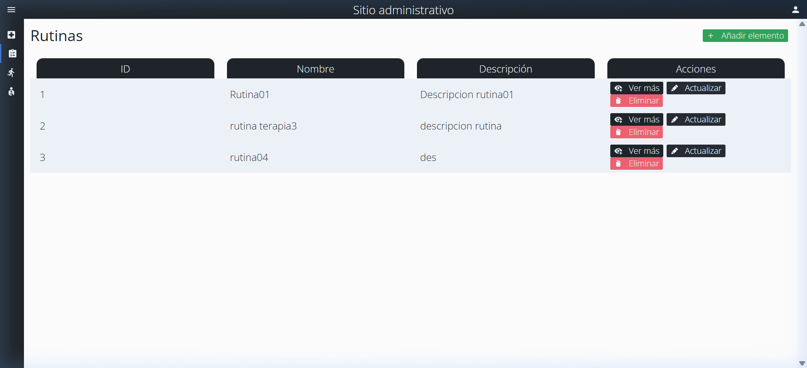
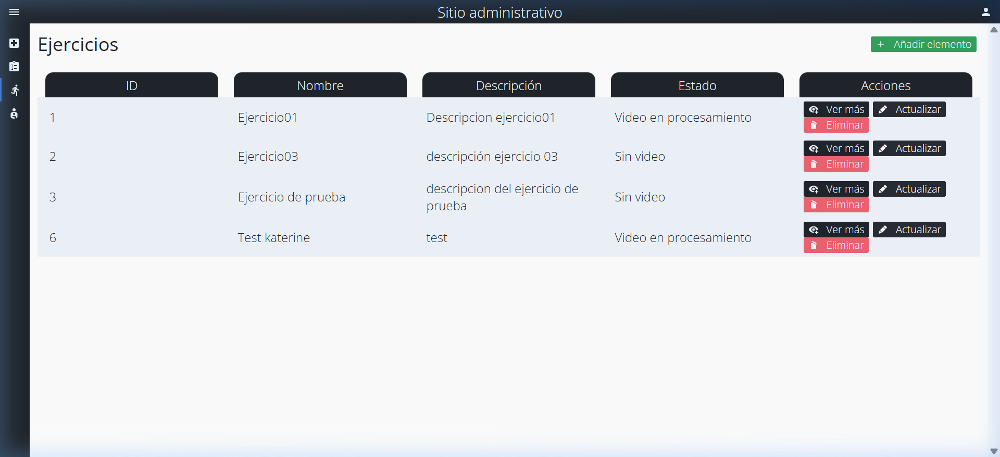
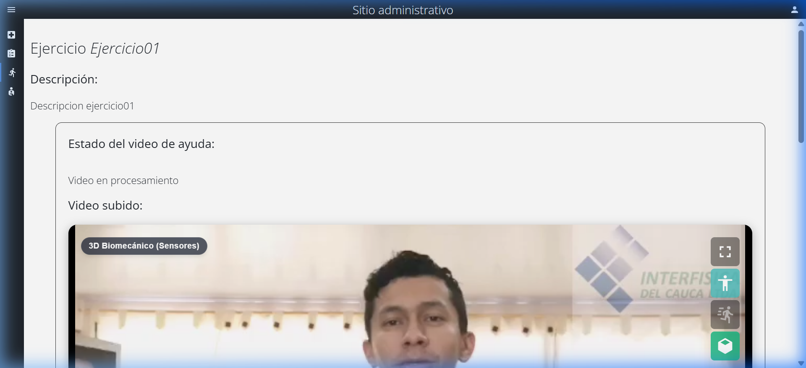
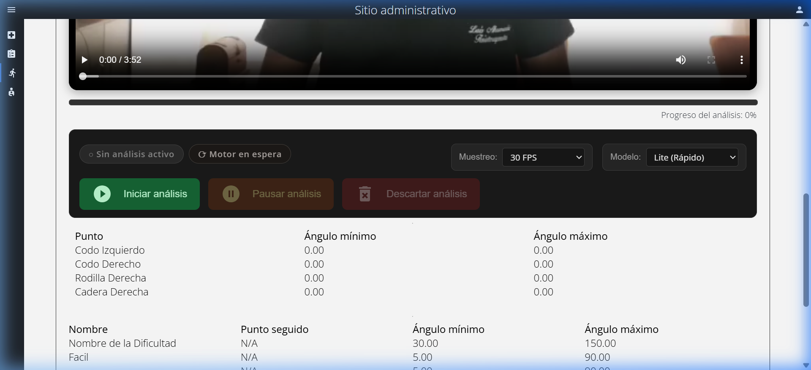
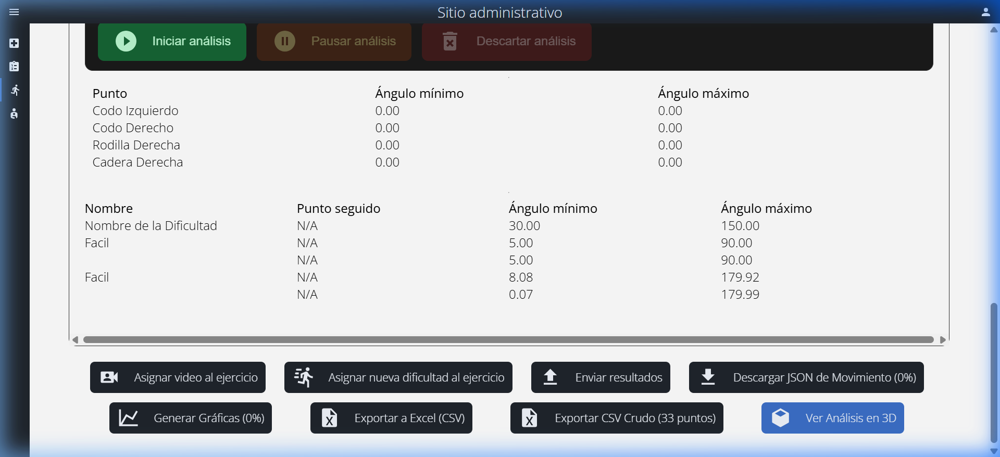
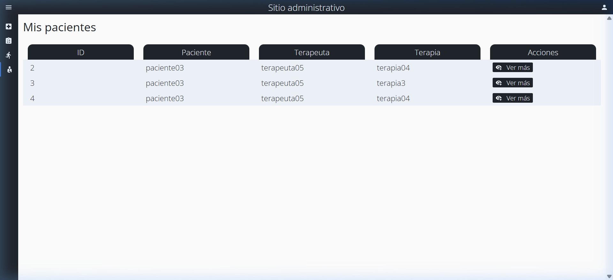

# Manual de Usuario — Plataforma de Telerehabilitación (Panel Administrativo)

> **Versión:** 1.0  
> **Fecha:** Agosto 2026  
> **Audiencia:** Terapeutas y Administradores del sistema

---

## Tabla de Contenidos

1. [Introducción](#1-introducción)
2. [Requisitos del Sistema](#2-requisitos-del-sistema)
3. [Acceso al Sistema](#3-acceso-al-sistema)
4. [Navegación General](#4-navegación-general)
5. [Casos de Uso](#5-casos-de-uso)
   - 5.1 [Gestión de Terapias](#51-gestión-de-terapias)
   - 5.2 [Gestión de Rutinas](#52-gestión-de-rutinas)
   - 5.3 [Gestión de Ejercicios](#53-gestión-de-ejercicios)
   - 5.4 [Análisis de Movimiento con IA](#54-análisis-de-movimiento-con-ia)
   - 5.5 [Exportación de Datos](#55-exportación-de-datos)
   - 5.6 [Visualización 3D](#56-visualización-3d)
   - 5.7 [Gestión de Pacientes](#57-gestión-de-pacientes)
   - 5.8 [Gestión de Usuarios (Administrador)](#58-gestión-de-usuarios-administrador)
6. [Preguntas Frecuentes](#6-preguntas-frecuentes)

---

## 1. Introducción

La **Plataforma de Telerehabilitación** es un sistema web diseñado para facilitar el seguimiento remoto de pacientes en procesos de rehabilitación física. Permite a los terapeutas:

- Crear y gestionar terapias, rutinas y ejercicios de rehabilitación.
- Analizar videos de ejercicios mediante **inteligencia artificial (MediaPipe Pose)** para detectar puntos esqueléticos y medir ángulos articulares.
- Exportar datos biomecánicos en formatos CSV, JSON y Excel.
- Visualizar el movimiento del paciente en un visor 3D interactivo.
- Asignar rutinas a pacientes y hacer seguimiento de sus resultados.

---

## 2. Requisitos del Sistema

| Requisito | Especificación |
|---|---|
| **Navegador** | Google Chrome 90+ (recomendado), Edge, Firefox |
| **Conexión** | Internet estable (para cargar videos y comunicarse con el servidor) |
| **Pantalla** | Resolución mínima 1280×720 |
| **Dispositivo** | PC o portátil con GPU compatible con WebGL (para análisis de IA) |

> **Nota:** El análisis de movimiento con MediaPipe se ejecuta directamente en tu navegador (client-side). Un equipo con más potencia de cómputo procesará los videos más rápido.

---

## 3. Acceso al Sistema

### 3.1 Inicio de Sesión

Para acceder al panel administrativo, abre tu navegador y dirígete a la URL del sistema. Se mostrará la pantalla de inicio de sesión.

**Pasos:**
1. Ingrese su **nombre de usuario** en el campo correspondiente.
2. Ingrese su **contraseña**.
3. Haga clic en **"Iniciar sesión"**.

> **Roles disponibles:**
> - **Terapeuta:** Acceso a terapias, rutinas, ejercicios y pacientes asignados.
> - **Administrador:** Acceso completo, incluyendo gestión de terapeutas, pacientes y otros administradores.

### 3.2 Pantalla Principal (Dashboard)

Tras iniciar sesión exitosamente, será redirigido a la pantalla principal del sistema.

---

## 4. Navegación General

El sistema cuenta con una **barra lateral (sidebar)** a la izquierda que contiene las secciones principales. Puede expandirla o colapsarla haciendo clic en el ícono de menú (☰) en la parte superior.

### Secciones disponibles según rol:

| Sección | Terapeuta | Administrador |
|---|:---:|:---:|
| Terapias | ✅ | ✅ |
| Rutinas | ✅ | ✅ |
| Ejercicios | ✅ | ✅ |
| Mis Pacientes | ✅ | ❌ |
| Administradores | ❌ | ✅ |
| Terapeutas | ❌ | ✅ |
| Pacientes | ❌ | ✅ |

---

## 5. Casos de Uso

### 5.1 Gestión de Terapias

**Actor:** Terapeuta / Administrador

Una **terapia** es el plan de tratamiento general que se asigna a un paciente. Cada terapia puede contener múltiples rutinas.

#### CU-01: Crear una nueva terapia
1. Navegue a **Terapias** en la barra lateral.
2. Haga clic en **"Agregar nuevo"**.
3. Complete los campos requeridos: nombre, descripción, fecha de inicio, fecha de fin.
4. Haga clic en **"Guardar"**.

#### CU-02: Ver detalles de una terapia
1. En la lista de terapias, haga clic en **"Ver más"** en la fila deseada.
2. Se mostrará la información completa de la terapia, los pacientes inscritos y las rutinas asignadas.

#### CU-03: Inscribir un paciente en una terapia
1. Desde el detalle de la terapia, haga clic en **"Inscribir paciente"**.
2. Seleccione al paciente de la lista disponible.
3. Confirme la inscripción.

#### CU-04: Asignar una rutina a una terapia
1. Desde el detalle de la terapia, haga clic en **"Asignar rutina"**.
2. Seleccione la rutina previamente creada.
3. Confirme la asignación.

---

### 5.2 Gestión de Rutinas

**Actor:** Terapeuta / Administrador

Una **rutina** es una secuencia de ejercicios que el paciente debe realizar. Las rutinas se asignan a las terapias.

#### CU-05: Crear una nueva rutina
1. Navegue a **Rutinas** en la barra lateral.
2. Haga clic en **"Agregar nuevo"**.
3. Asigne un nombre y descripción a la rutina.
4. Seleccione los ejercicios que conforman la rutina (puede seleccionar múltiples).
5. Haga clic en **"Guardar"**.

#### CU-06: Editar una rutina existente
1. En la lista de rutinas, haga clic en **"Ver más"** para ver su detalle.
2. Utilice el botón de edición para modificar los ejercicios o la información general.
3. Guarde los cambios.

---

### 5.3 Gestión de Ejercicios

**Actor:** Terapeuta / Administrador

Un **ejercicio** es la unidad fundamental de la plataforma. Contiene una descripción, un video de referencia, y los puntos esqueléticos a rastrear durante el análisis.

#### CU-07: Crear un nuevo ejercicio
1. Navegue a **Ejercicios** en la barra lateral.
2. Haga clic en **"Agregar nuevo"**.
3. Complete el nombre, descripción y seleccione los puntos esqueléticos a rastrear usando el **Selector de Esqueleto** interactivo.
4. Haga clic en **"Guardar"**.

#### CU-08: Asignar un video a un ejercicio
1. Desde el detalle del ejercicio, haga clic en **"Asignar video al ejercicio"**.
2. Seleccione el archivo de video desde su equipo.
3. El video se subirá y procesará automáticamente.

#### CU-09: Ver detalles de un ejercicio
1. Haga clic en **"Ver más"** en la lista de ejercicios.
2. Se mostrarán todos los detalles del ejercicio, incluyendo el video, los puntos rastreados, las dificultades y los resultados del análisis.

#### CU-10: Asignar una dificultad a un ejercicio
1. Desde el detalle del ejercicio, haga clic en **"Asignar nueva dificultad al ejercicio"**.
2. Configure los rangos de ángulo mínimo y máximo para cada punto rastreado.
3. Guarde la configuración.

---

### 5.4 Análisis de Movimiento con IA

**Actor:** Terapeuta / Administrador

Esta es la funcionalidad central del sistema. Permite analizar automáticamente un video de ejercicio para detectar la postura del paciente frame por frame, calcular ángulos articulares y generar datos biomecánicos.

#### CU-11: Iniciar un análisis de movimiento

**Precondición:** El ejercicio debe tener un video asignado y procesado.

1. Navegue al detalle del ejercicio.
2. En el **Panel de Análisis**, configure los parámetros:
   - **Muestreo (FPS):** Frecuencia de captura. 15 FPS para análisis ligero, 30 FPS para estándar, o la frecuencia original del video.
   - **Modelo:** Seleccione la precisión del modelo de IA:
     - **Lite (Rápido):** Menor consumo de recursos, ideal para análisis rápidos.
     - **Full (Balanceado):** Balance entre velocidad y precisión.
     - **Heavy (Preciso):** Máxima precisión, mayor consumo de recursos.
3. Haga clic en **"Iniciar análisis"**.
4. El análisis se ejecutará en **segundo plano**. Una barra de progreso mostrará el avance.
5. Puede seguir navegando por la aplicación mientras el análisis se completa.

> **Indicadores de estado:**
> - 🟢 **Motor listo:** El motor de IA está cargado y listo.
> - 🔵 **Analizando en segundo plano:** El análisis está en progreso.
> - ⟳ **Motor en espera:** El motor aún no se ha inicializado.

#### CU-12: Pausar y reanudar un análisis
1. Durante un análisis en progreso, haga clic en **"Pausar análisis"**.
2. El análisis se detendrá en el frame actual.
3. Para reanudar, haga clic en **"Reanudar análisis"**. El análisis continuará desde donde se detuvo.

#### CU-13: Descartar un análisis
1. Haga clic en **"Descartar análisis"**.
2. Confirme en el diálogo de confirmación.
3. Todos los frames capturados se eliminarán.

> **Nota:** La preferencia de modelo seleccionada se guarda automáticamente en su navegador. Al recargar la página, el sistema recordará su última selección.

#### Detección de esqueleto en tiempo real

El reproductor de video incluye detección de esqueleto en tiempo real. Al reproducir el video, verá superpuesto:

- **Puntos esqueléticos** (33 landmarks del cuerpo humano).
- **Conexiones** entre puntos adyacentes (huesos).
- **Ángulos articulares** calculados para los puntos rastreados.

Puede alternar entre vista 2D y 3D usando el botón correspondiente.

---

### 5.5 Exportación de Datos

**Actor:** Terapeuta / Administrador

Una vez completado (o parcialmente completado) el análisis, puede exportar los resultados en diferentes formatos.

#### CU-14: Descargar JSON de movimiento
1. Haga clic en **"Descargar JSON de Movimiento"**.
2. Se descargará un archivo `.json` que contiene todos los frames capturados con timestamps, coordenadas de los 33 landmarks y ángulos articulares.

#### CU-15: Exportar a CSV (Excel) — Filtrado por puntos rastreados
1. Haga clic en **"Exportar a Excel (CSV)"**.
2. Se descargará un archivo `.csv` con una fila por frame, incluyendo:
   - Timestamp
   - Ángulos articulares de cada punto rastreado
   - Coordenadas (x, y, z, visibility) de cada punto rastreado

#### CU-16: Exportar CSV crudo (33 puntos)
1. Haga clic en **"Exportar CSV Crudo (33 puntos)"**.
2. Se descargará un archivo `.csv` con las coordenadas de los 33 landmarks del cuerpo completo para cada frame.

#### CU-17: Enviar resultados al servidor
1. Haga clic en **"Enviar resultados"**.
2. Los datos del análisis se enviarán a la API del servidor para almacenamiento permanente.

#### CU-18: Generar gráficas
1. Haga clic en **"Generar Gráficas"**.
2. Se mostrarán gráficas interactivas (Chart.js) con:
   - Ángulos articulares a lo largo del tiempo.
   - Estadísticas de mínimo, máximo y promedio por punto rastreado.

---

### 5.6 Visualización 3D

**Actor:** Terapeuta / Administrador

#### CU-19: Ver análisis en visor 3D
1. Desde el detalle del ejercicio, haga clic en **"Ver Análisis en 3D"**.
2. Se abrirá un visor tridimensional (Three.js) que muestra el esqueleto del paciente.
3. Puede rotar, hacer zoom y navegar por la escena 3D.

---

### 5.7 Gestión de Pacientes

**Actor:** Terapeuta

#### CU-20: Ver mis pacientes asignados
1. Navegue a **"Mis pacientes"** en la barra lateral.
2. Se mostrará la lista de pacientes asignados al terapeuta actual.

#### CU-21: Ver progreso de un paciente
1. Haga clic en **"Ver más"** en la fila del paciente.
2. Se mostrará el historial de rutinas asignadas y los resultados de cada ejercicio.

#### CU-22: Revisar resultados de un ejercicio del paciente
1. Desde el perfil del paciente, navegue a la rutina específica.
2. Haga clic en el resultado del ejercicio para ver los datos biomecánicos y las métricas obtenidas.

---

### 5.8 Gestión de Usuarios (Administrador)

**Actor:** Administrador

#### CU-23: Crear un nuevo terapeuta
1. Navegue a **"Terapeutas"** en la barra lateral.
2. Haga clic en **"Agregar nuevo"**.
3. Complete los datos del terapeuta: nombre, usuario, contraseña, email.
4. Haga clic en **"Guardar"**.

#### CU-24: Crear un nuevo paciente
1. Navegue a **"Pacientes"** en la barra lateral.
2. Haga clic en **"Agregar nuevo"**.
3. Complete los datos del paciente.
4. Haga clic en **"Guardar"**.

#### CU-25: Crear un nuevo administrador
1. Navegue a **"Administradores"** en la barra lateral.
2. Haga clic en **"Agregar nuevo"**.
3. Complete los datos.
4. Haga clic en **"Guardar"**.

---

## 6. Preguntas Frecuentes

### ¿El análisis se pierde si recargo la página?
No. El análisis se guarda periódicamente en la base de datos local del navegador (IndexedDB). Si recarga la página, el progreso anterior se recuperará automáticamente y podrá reanudar o ver los datos existentes.

### ¿Puedo cambiar de pestaña durante el análisis?
Sí. El sistema está optimizado para seguir procesando el video incluso cuando la pestaña del navegador está en segundo plano, utilizando Web Workers y canales de comunicación internos (MessageChannel) para evitar las restricciones de ralentización del navegador.

### ¿Qué modelo de IA debo elegir?
- **Lite:** Para pruebas rápidas o equipos con recursos limitados.
- **Full (recomendado):** Para la mayoría de los análisis clínicos.
- **Heavy:** Cuando se requiere máxima precisión en la detección de puntos esqueléticos.

### ¿Por qué mi preferencia de modelo se conserva tras recargar?
El sistema almacena su preferencia de modelo en `localStorage` del navegador. Cualquier cambio que realice se aplicará automáticamente en futuras sesiones.

### ¿En qué formato debo subir los videos?
Se recomienda formato **MP4 (H.264)**, que es el formato más compatible con todos los navegadores modernos.
